# CompTIA Network+ Project: Small Company Network with VLANs, DHCP, DNS and ACL

## Objective
Design, build, and test a small company network in Cisco Packet Tracer. The network uses VLAN segmentation, inter-VLAN routing (router-on-a-stick), a central DHCP and DNS server, and an access control list (ACL) that isolates guest users from staff and servers.

## Skills Demonstrated
- VLAN creation and port assignment
- 802.1Q trunking
- Inter-VLAN routing with subinterfaces
- DHCP server configuration and DHCP relay (`ip helper-address`)
- DNS server configuration
- Extended ACLs
- Testing and troubleshooting (`ping`, `tracert`, `nslookup`, `ipconfig`)

## Tools
Cisco Packet Tracer 9.0.1

## IP Addressing Plan

| VLAN | Name | Network | Gateway | Devices |
|---|---|---|---|---|
| 10 | STAFF | 192.168.10.0/24 | 192.168.10.1 | Staff-PC1, Staff-PC2 |
| 20 | GUEST | 192.168.20.0/24 | 192.168.20.1 | Guest-PC1, Guest-PC2 |
| 30 | SERVERS | 192.168.30.0/24 | 192.168.30.1 | DNS-DHCP-Server (192.168.30.10) |

## Topology
Staff PCs are in VLAN 10, Guest PCs in VLAN 20, and the server in VLAN 30. SW1 connects to R1 over an 802.1Q trunk on Fa0/1.

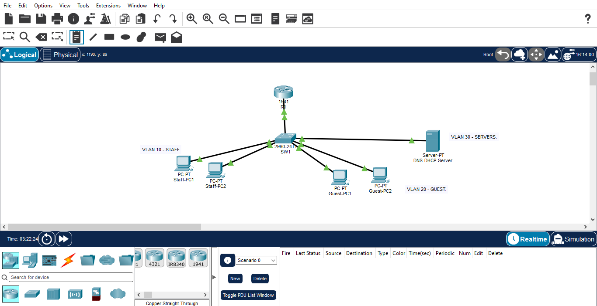

Initial build before configuration:

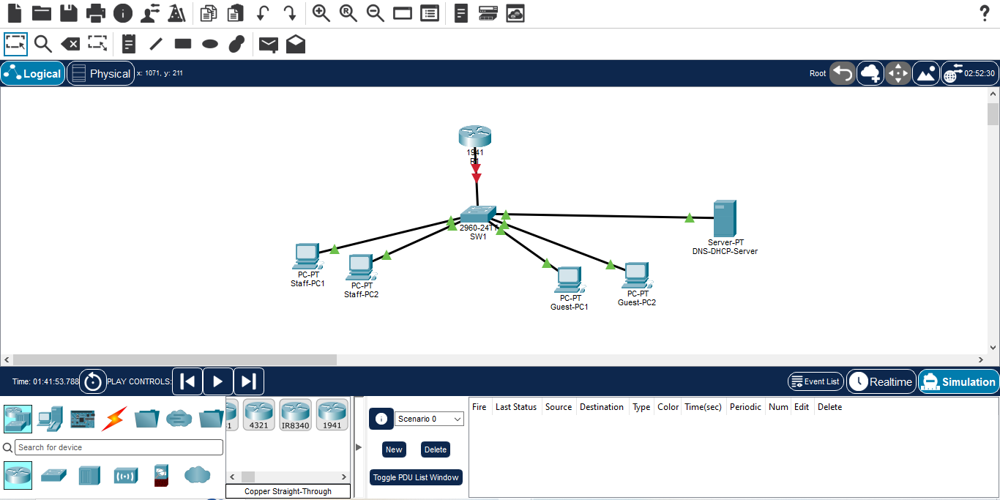

## Configuration

### 1. Switch: VLANs and trunk
Created VLANs 10, 20 and 30, assigned access ports, and configured Fa0/1 as a trunk to the router.

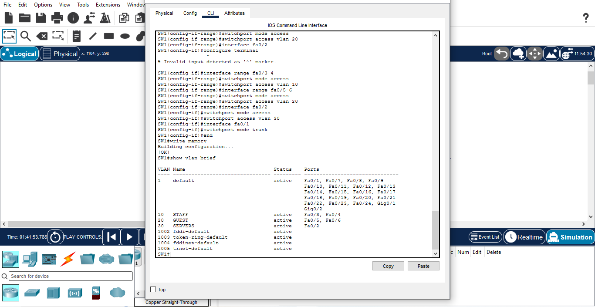

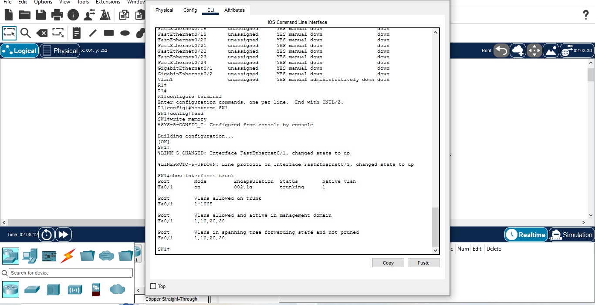

### 2. Router: inter-VLAN routing
Configured subinterfaces Gig0/0.10, .20 and .30 with 802.1Q encapsulation, plus `ip helper-address 192.168.30.10` on the Staff and Guest subinterfaces to relay DHCP requests to the server.

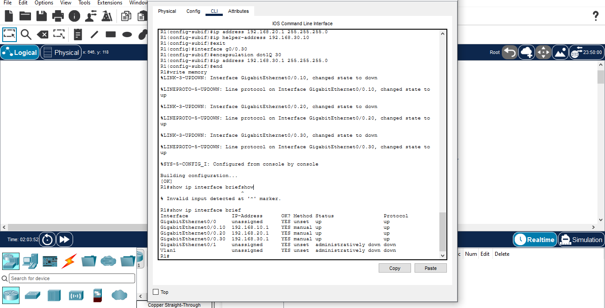

### 3. Server: static IP, DHCP and DNS
The server uses the static address 192.168.30.10. DHCP pools were created for Staff and Guest, and a DNS record maps `intranet.company.local` to 192.168.30.10.

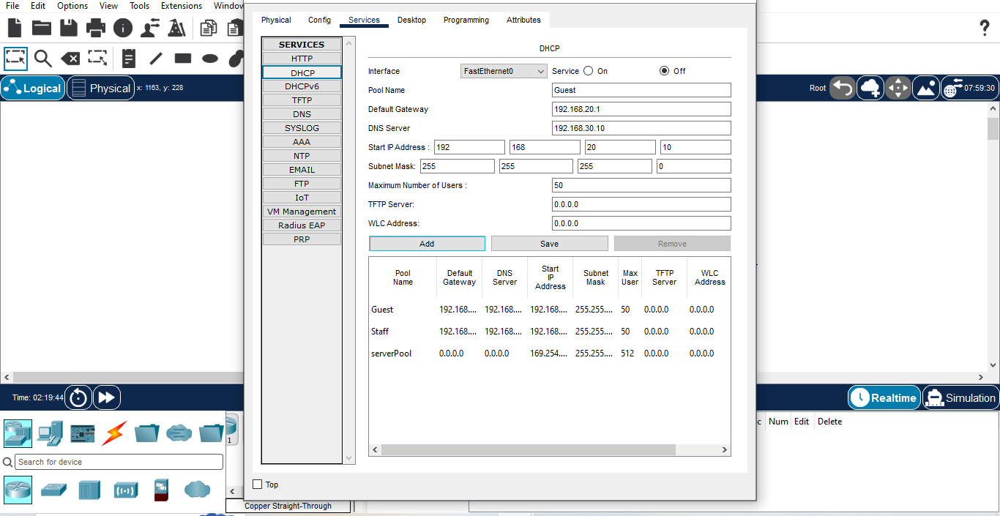

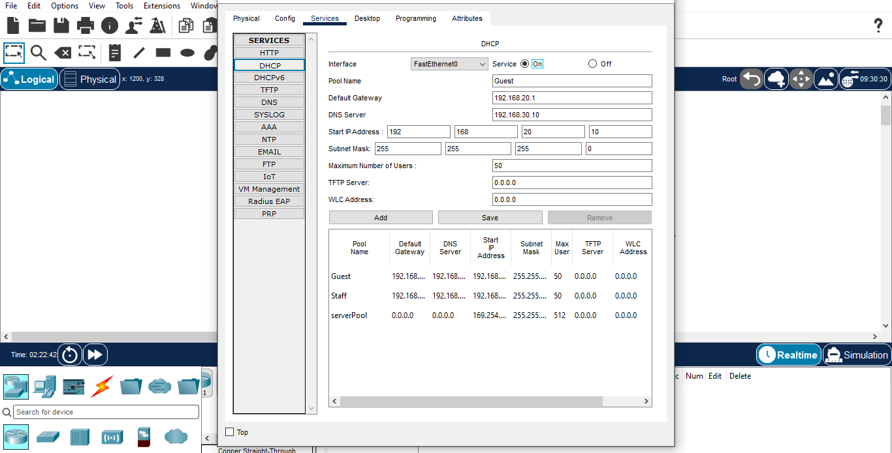

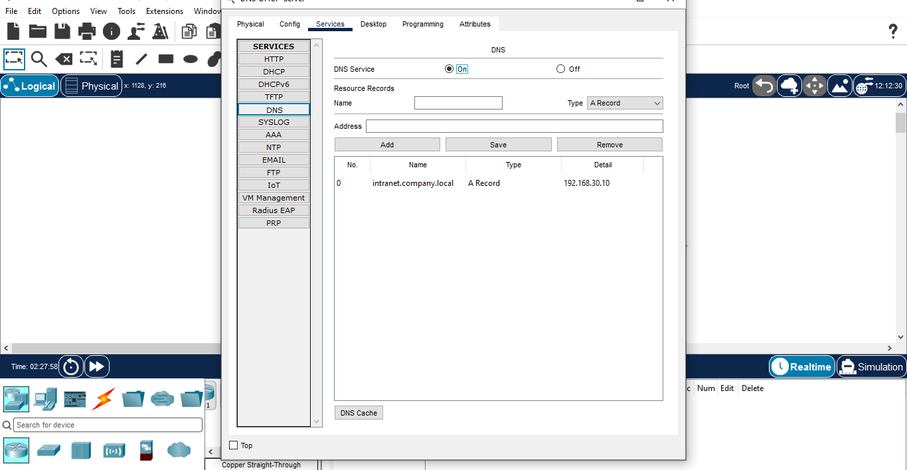

## Testing (before the ACL)

### DHCP
Both PC groups received addresses automatically from the correct pools.

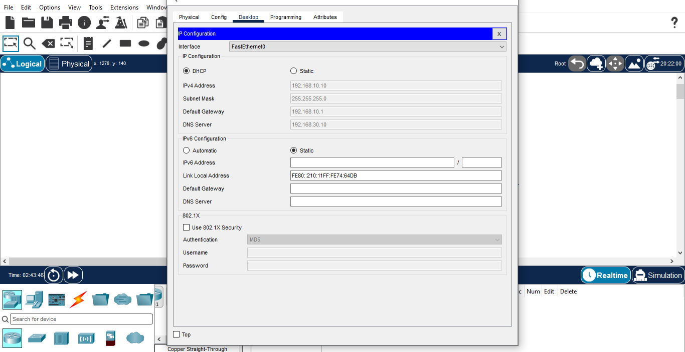

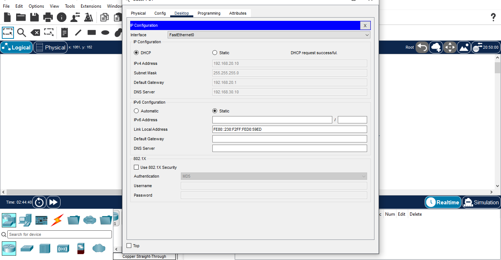

### Connectivity and inter-VLAN routing
Staff-PC1 reached the router, the server, and a Guest PC. The `tracert` output shows traffic passing through the router (192.168.10.1), which confirms inter-VLAN routing.

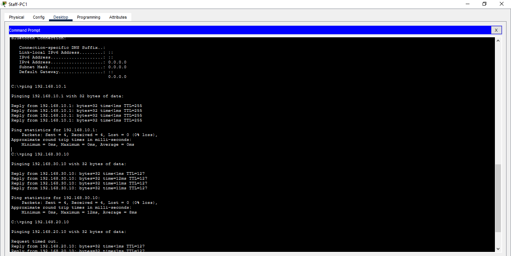

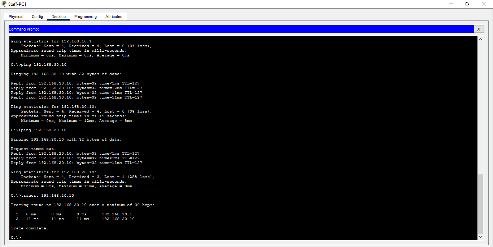

### DNS
`nslookup` resolved `intranet.company.local` to 192.168.30.10.

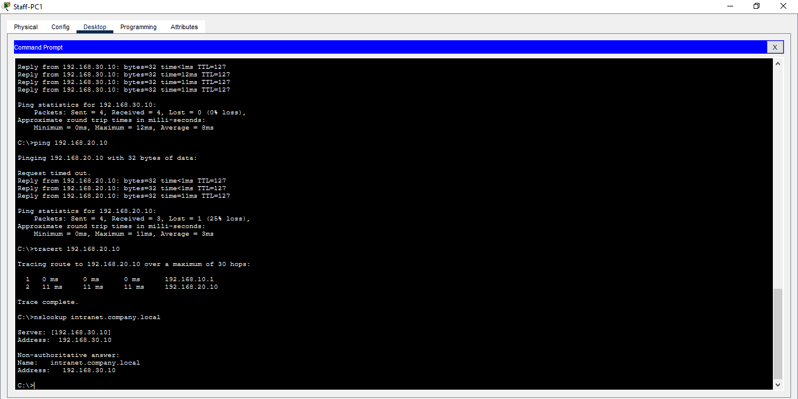

### Guest to Staff, before the ACL
Before the ACL, Guest-PC1 could reach Staff-PC1.

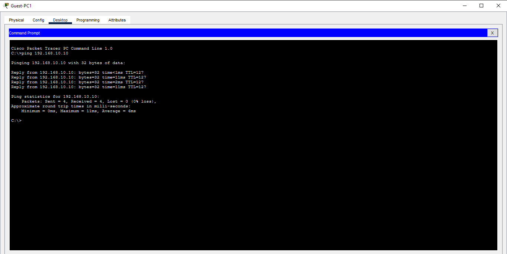

## Security: Extended ACL
Created `GUEST_ACL` and applied it inbound on `Gig0/0.20`. It permits DHCP and DNS for guests, blocks guests from the Staff and Server networks, and allows all other traffic.

```
ip access-list extended GUEST_ACL
 permit udp any any eq 67
 permit udp any host 192.168.30.10 eq 53
 deny ip 192.168.20.0 0.0.0.255 192.168.10.0 0.0.0.255
 deny ip 192.168.20.0 0.0.0.255 192.168.30.0 0.0.0.255
 permit ip any any
interface g0/0.20
 ip access-group GUEST_ACL in
```

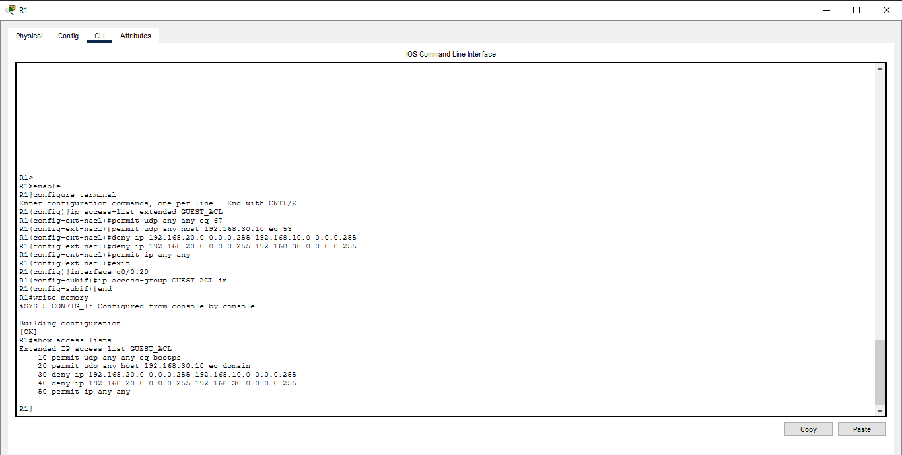

## Testing (after the ACL)
Guest-PC1 can no longer reach Staff or the server ("Destination host unreachable"), but DNS still works.

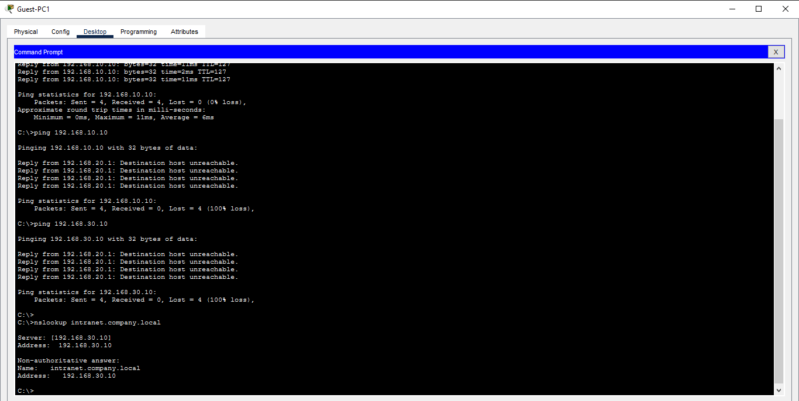

Staff can still reach Guest devices, because the ACL only filters traffic coming from the Guest VLAN.

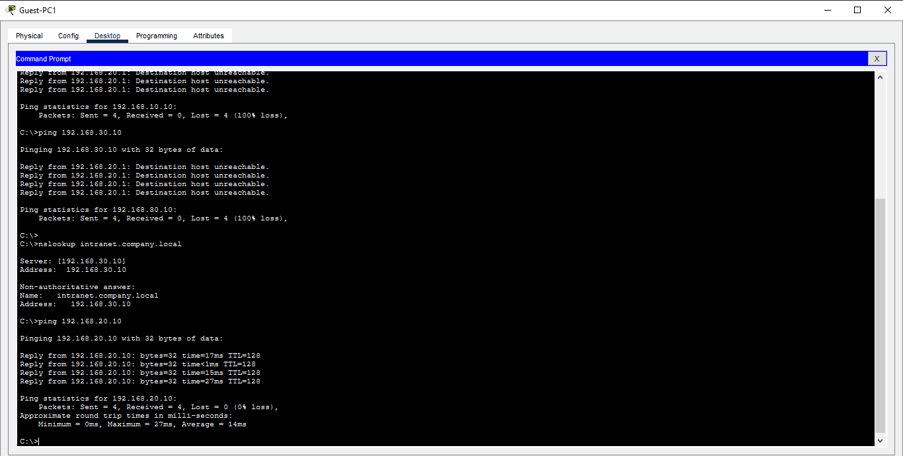

The ACL match counters show the deny rules being hit.

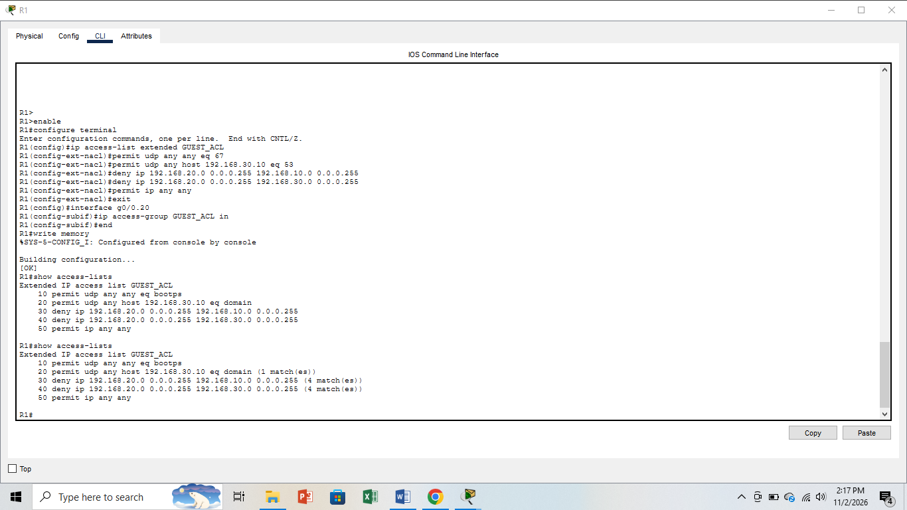

## Files
- `company-network.pkt`: the Packet Tracer project
- `configs/R1-config.txt`: router configuration
- `configs/SW1-config.txt`: switch configuration
- `screenshots/`: proof of each build and test step

## What I Learned
- How VLANs separate traffic on one switch, and how a router connects them
- Why DHCP requests need a relay (`ip helper-address`) to cross VLANs
- Why ACL order matters: DHCP and DNS had to be permitted before the deny rules
- How to troubleshoot with CLI modes, `show` commands, and step-by-step checks, for example tracing a DHCP failure from the PC back to the server

## Possible Improvements
- Add a Wi-Fi access point for the Guest VLAN
- Add NAT and an internet-facing link
- Add port security on the switch access ports
- Add a second switch with EtherChannel
